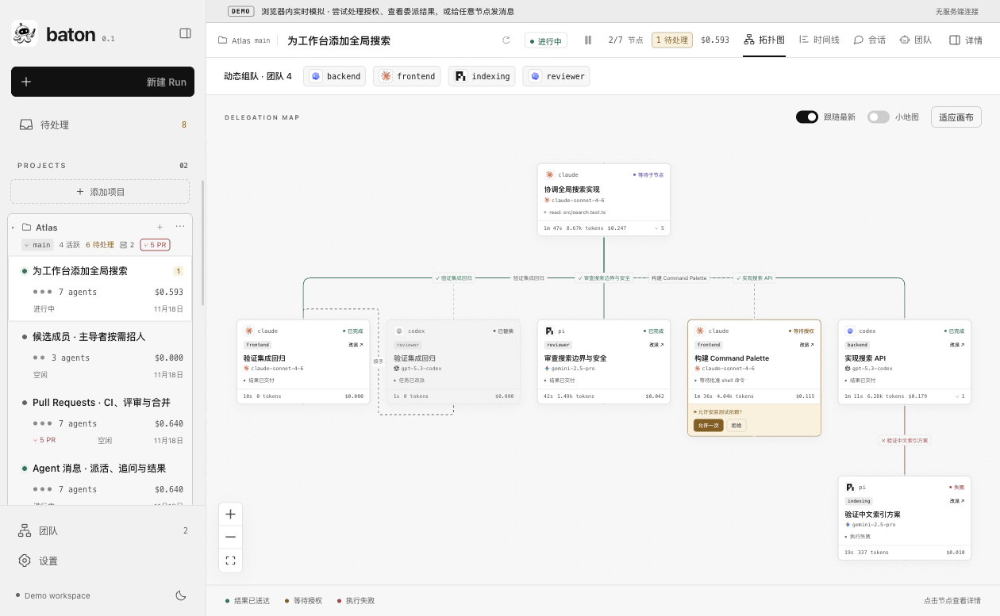
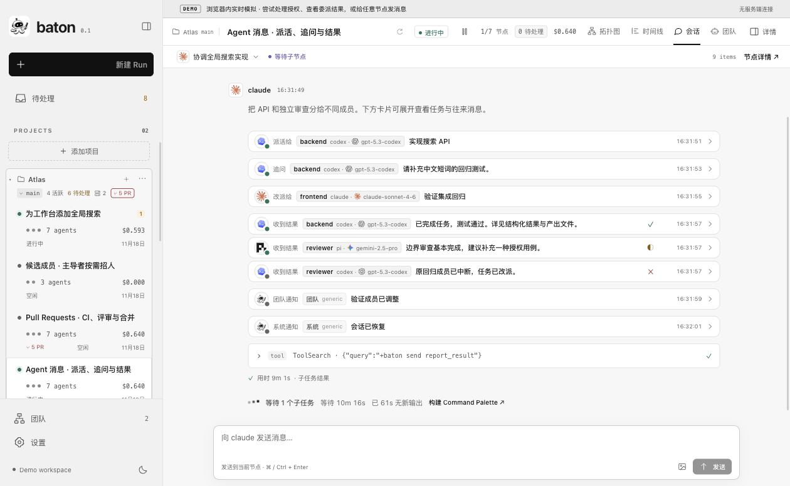
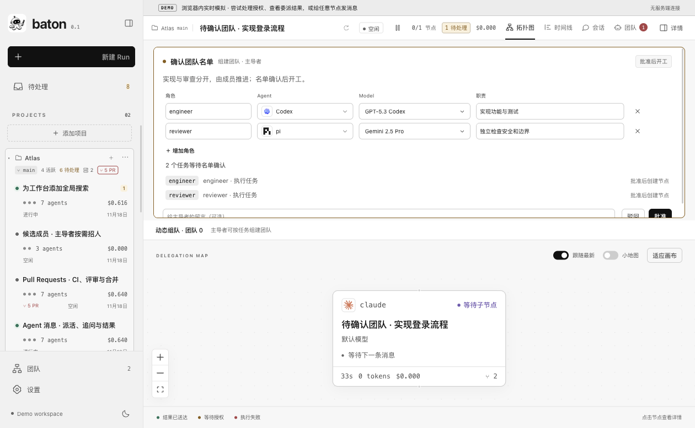

<p align="center"></p>

# baton

[中文](README.md) | **English**

Local agent client with **native delegation** and **observability**. baton detects and drives the agent CLIs already installed on your machine (Claude Code, Codex, pi, and any ACP agent such as Gemini CLI, Qwen Code, Kimi, OpenCode, Goose…) instead of running its own agent loop.

- **Agents you already have.** 53 built-in agents: native Claude Code (Agent SDK), Codex (app-server) and pi (RPC), plus 50 ACP agents (OpenCode, Qwen Code, Gemini CLI, Kimi, Copilot, Cursor, Grok, Goose…). Detected from your PATH with version gates and install hints; every spec can be overridden in `config.json`.
- **Native delegation.** Every agent gets a per-node `baton` MCP server (`delegate`, `wait`, `send`, `reassign`, `report_result`, `ask_human`, team tools…). Any agent can delegate to any detected agent, across vendors; results flow back automatically. Collaboration modes: dynamic teams (with roster approval), preset teams, or solo.
- **Human in the loop.** Cross-run inbox for permissions, team proposals, inline question cards and escalations; permission rules; queue / steer / interrupt sending modes; pause and resume.
- **Observability.** Live delegation topology, a session timeline (idle gaps compressed), full transcripts with GFM + Mermaid, per-turn timing, background processes started by agents, and pull requests they open (with CI / review status).
- **Projects and desktop.** Every session belongs to a project (working directory). Electron desktop app for macOS and Windows with a native folder picker; the same console also runs in a browser.

Design: [docs/DESIGN.md](docs/DESIGN.md).



| Conversation and agent messages | Team roster approval |
| --- | --- |
|  |  |
| **Inline question cards** | **Session timeline (idle gaps folded)** |
|  |  |

Screenshots are from the console's built-in demo mode (open without a token or with `?demo=1`); the UI is currently Chinese.

## Download

Get the desktop app from [Releases](https://github.com/DueGin/baton/releases): `baton-<version>-mac-arm64|x64.dmg/.zip` and `baton-<version>-win-x64.exe/.zip`. Builds are unsigned — on macOS right-click → Open (or `xattr -dr com.apple.quarantine /Applications/baton.app`); on Windows choose "More info → Run anyway" in SmartScreen.

## Run

```bash
npm install
npm run build                      # protocol → providers → server → web
node packages/server/dist/cli/main.js serve          # http://127.0.0.1:7433/#token=…
node packages/server/dist/cli/main.js serve --fake   # demo agents, no real CLIs needed
```

Desktop app: see [packages/desktop/README.md](packages/desktop/README.md) (`npm run dist:mac`, `npm run dist:win`; unsigned builds).

Release: push a `v*` tag (e.g. `git tag v0.2.0 && git push origin v0.2.0`) and [the Release workflow](.github/workflows/release.yml) builds macOS arm64/x64 + Windows x64 and publishes a GitHub Release with checksums; tags with a `-` suffix become pre-releases.

Development: `npm run dev` (daemon via tsx) and `npm run dev:web` (Vite on :5173, proxies to :7433; without a token it runs an in-browser demo).

CLI: `baton agents [--refresh]`, `baton runs`, `baton run <agent> "<prompt>" [--cwd] [--model] [--mode] [--auto-approve] [--follow]`, `baton export <runId> --format json|md|otlp`.

Data lives in `~/.baton` (override with `BATON_HOME`). The daemon listens on 127.0.0.1 only and requires the token in `~/.baton/token`.

## Verify

```bash
npm run typecheck && npx vitest run
npx tsx packages/server/scripts/smoke-drivers.ts claude codex pi   # real CLIs + network
```

Provider adapters are derived from [Paseo](https://github.com/getpaseo/paseo) (Apache-2.0); see NOTICE.
