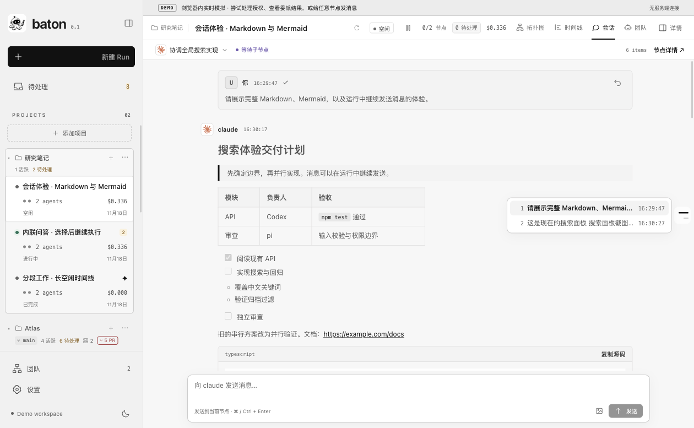
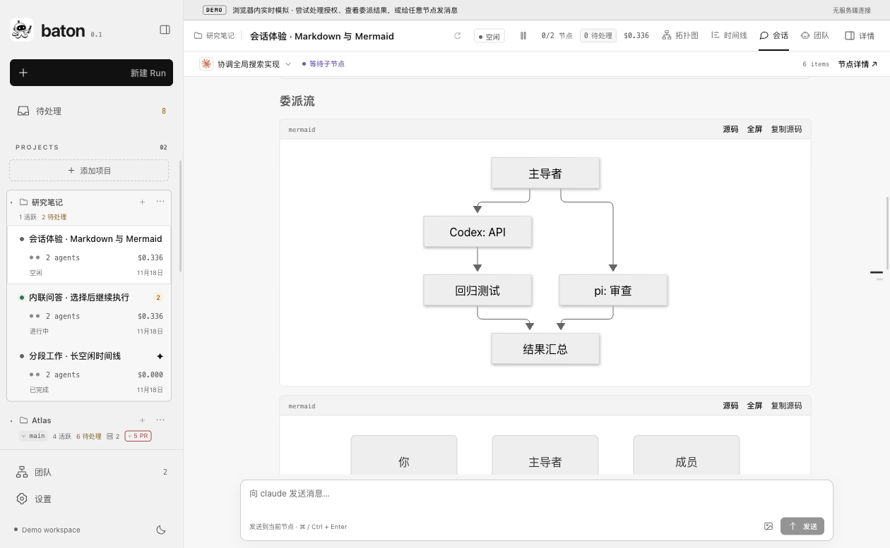
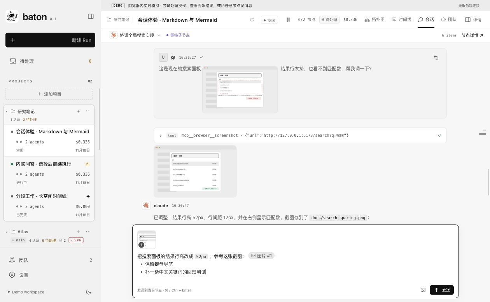
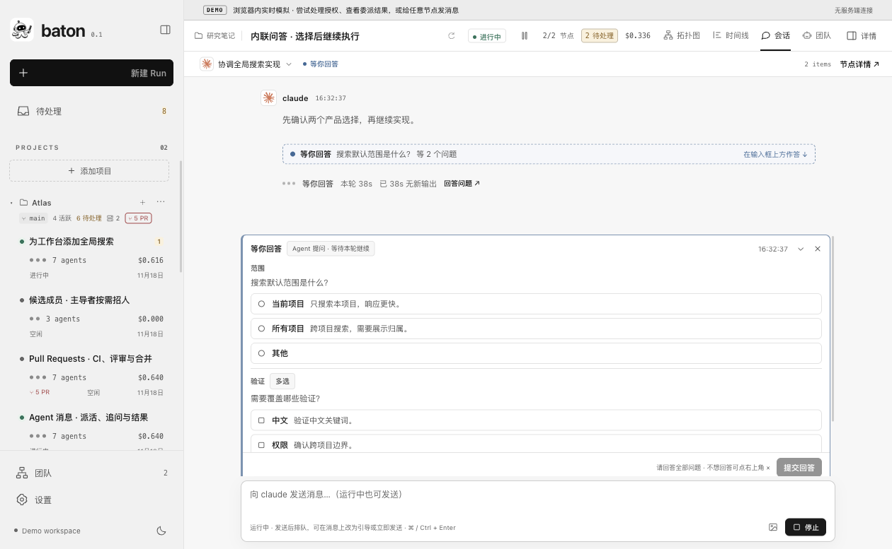
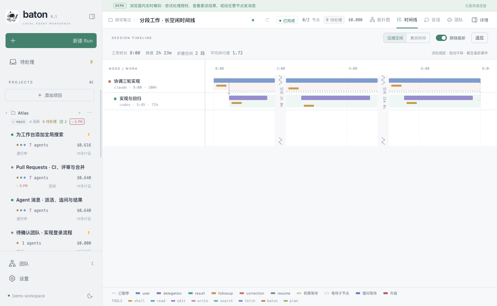
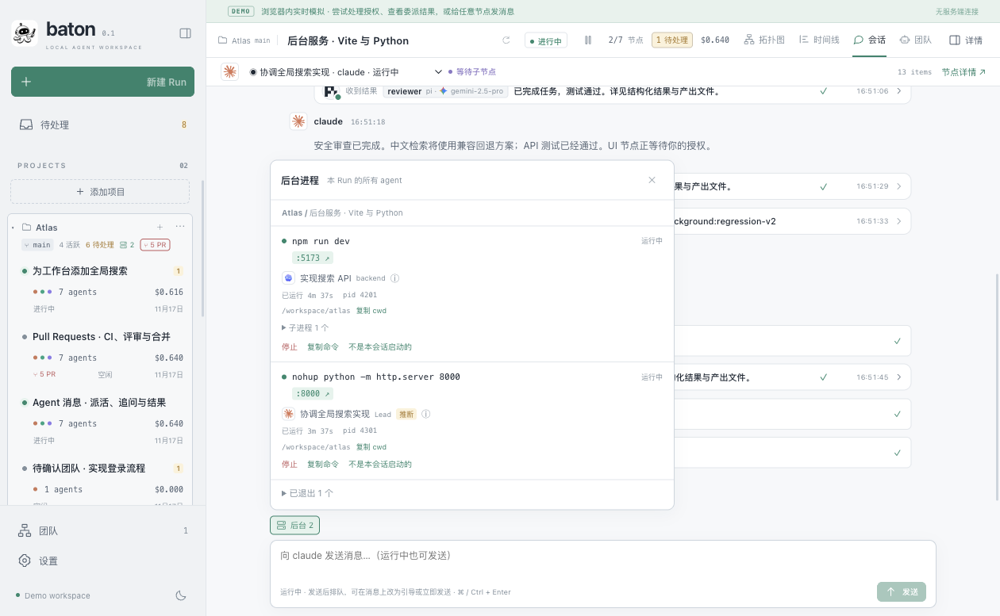
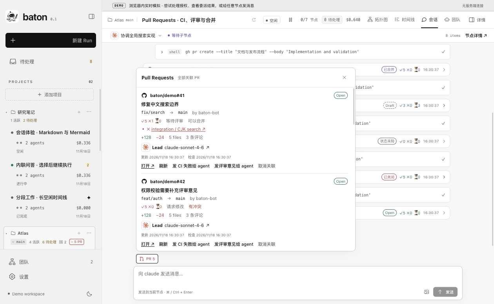

<p align="center"></p>

# baton

[中文](README.md) | **English**

Local agent client with **native delegation** and **observability**. baton detects and drives the agent CLIs already installed on your machine (Claude Code, Codex, pi, and any ACP agent such as Gemini CLI, Qwen Code, Kimi, OpenCode, Goose…) instead of running its own agent loop.

- **Agents you already have.** 53 built-in agents: native Claude Code (Agent SDK), Codex (app-server) and pi (RPC), plus 50 ACP agents (OpenCode, Qwen Code, Gemini CLI, Kimi, Copilot, Cursor, Grok, Goose…). Detected from your PATH with version gates and install hints; every spec can be overridden in `config.json`.
- **Native delegation.** Every agent gets a per-node `baton` MCP server (`delegate`, `wait`, `send`, `reassign`, `report_result`, `ask_human`, team tools…). Any agent can delegate to any detected agent, across vendors; results flow back automatically. Collaboration modes: dynamic teams (with roster approval), preset teams, or solo. Dynamic and preset teams can carry candidate members (agent, model, thinking level, optional description, no role) that the lead hires on its own.
- **Agent-to-agent sessions.** Every agent session has an **Agent ID** (shown, copyable, in node and run details). Any agent can use `list_sessions` to find sessions in its run, other runs or other projects and `send_message` one of them by Agent ID; a busy receiver gets the message after its current turn, a finished one is woken up, and a reply comes back the same way. Ten messages between the same two sessions without a human in between stop the exchange and ask for one.
- **Human in the loop.** Cross-run inbox for permissions, team proposals, inline question cards and escalations; permission rules; queue / steer / interrupt sending modes; pause and resume; roll a message back (conversation, files, or both).
- **Conversation.** Live Markdown in the composer; images inline as pills for agents that accept them, and shown in the transcript; an outline rail to jump to any message you sent.
- **Observability.** Live delegation topology, a session timeline (idle gaps compressed), full transcripts with GFM + Mermaid, per-turn timing, background processes started by agents, and pull requests they open (with CI / review status).
- **Projects and desktop.** Every session belongs to a project (working directory). Electron desktop app for macOS and Windows with a native folder picker; the same console also runs in a browser. Light and dark themes.

Design: [docs/DESIGN.md](docs/DESIGN.md).


| New run: candidate members, models from the agent's config | Team roster approval |
| --- | --- |
|  |  |
| **Run team and candidates** | **Conversation and agent messages** |
|  |  |
| **Markdown and the outline rail** | **Mermaid diagrams** |
|  |  |
| **Composer: live Markdown and image pills** | **Message rollback: conversation, files or both** |
|  |  |
| **Inline question cards** | **Inbox** |
|  |  |
| **Session timeline (idle gaps folded)** | **Background processes** |
|  |  |
| **Pull request tracking (CI and reviews)** | **Dark theme** |
|  |  |


Screenshots are from the console's built-in demo mode (open without a token or with `?demo=1`); the UI is currently Chinese.

## Download

Get the desktop app from [Releases](https://github.com/DueGin/baton/releases): `baton-<version>-mac-arm64|x64.dmg/.zip` and `baton-<version>-win-x64.exe/.zip`. Builds are unsigned — on macOS right-click → Open (or `xattr -dr com.apple.quarantine /Applications/baton.app`); on Windows choose "More info → Run anyway" in SmartScreen.

### Updating

The desktop app updates itself; you don't have to come back for a new installer.

1. Settings → **更新** (Updates) → **检查更新** (Check for updates).
2. When a new version is listed, **下载** (Download) fetches it from GitHub Releases and verifies it against `SHA256SUMS.txt`. On a flaky network it retries and resumes where it stopped; if it still gives up, **继续下载** (Resume) continues from the partial file.
3. **立即安装并重启** (Install and restart) quits the app (asking first if runs are active), replaces it and reopens it. On macOS the `.app` is swapped in place; on Windows the NSIS installer runs silently. A failed swap restores the previous version.

The repository is public, so no token is needed to check for or download updates. Updates use the system proxy, and when the GitHub API is rate limited or unreachable the check falls back to the release's own `SHA256SUMS.txt` on github.com. A token is optional: anonymous GitHub API calls are limited to 60 per hour per IP, and private forks/releases need one. Set it under Settings → Updates (a fine-grained token with **Contents: Read**, or a classic one with `repo`) or export `GITHUB_TOKEN` in your login shell; it is stored only in `<user data>/desktop-settings.json` (mode 0600) on your machine.

You can still install manually from [Releases](https://github.com/DueGin/baton/releases) as before; projects, runs and settings live in `~/.baton` and are kept.

## Run

```bash
npm install
npm run build                      # protocol → providers → server → web
node packages/server/dist/cli/main.js serve          # http://127.0.0.1:7433/#token=…
node packages/server/dist/cli/main.js serve --fake   # demo agents, no real CLIs needed
```

Desktop app: see [packages/desktop/README.md](packages/desktop/README.md) (`npm run dist:mac`, `npm run dist:win`; unsigned builds).

Release: push a `v*` tag (e.g. `git tag v0.2.0 && git push origin v0.2.0`) and [the Release workflow](.github/workflows/release.yml) builds macOS arm64/x64 + Windows x64 and publishes a GitHub Release with checksums; tags with a `-` suffix become pre-releases.

Development: `npm run dev` (daemon via tsx) and `npm run dev:web` (Vite on :5173, proxies to :7433; without a token it runs an in-browser demo).

CLI: `baton agents [--refresh]`, `baton runs`, `baton run <agent> "<prompt>" [--cwd] [--model] [--mode] [--auto-approve] [--follow]`, `baton export <runId> --format json|md|otlp`.

Data lives in `~/.baton` (override with `BATON_HOME`). The daemon listens on 127.0.0.1 only and requires the token in `~/.baton/token`.

## Verify

```bash
npm run typecheck && npx vitest run
npx tsx packages/server/scripts/smoke-drivers.ts claude codex pi   # real CLIs + network
```

Provider adapters are derived from [Paseo](https://github.com/getpaseo/paseo) (Apache-2.0); see NOTICE.
