<p align="center"></p>

# baton

**中文** | [English](README.en.md)

一个**天然支持委派**、**全程可观测**的本地 agent 客户端。baton 不自己实现 agent 循环，而是识别并驱动你本机已经安装的 agent CLI（Claude Code、Codex、pi，以及 Gemini CLI、Qwen Code、Kimi、OpenCode、Goose 等任意 ACP agent），在它们之上补齐多 agent 协作：任意 agent 都能把任务派给其他 agent，结果自动回流，整个过程在拓扑图、时间线和会话里一目了然。

## 产品视频

[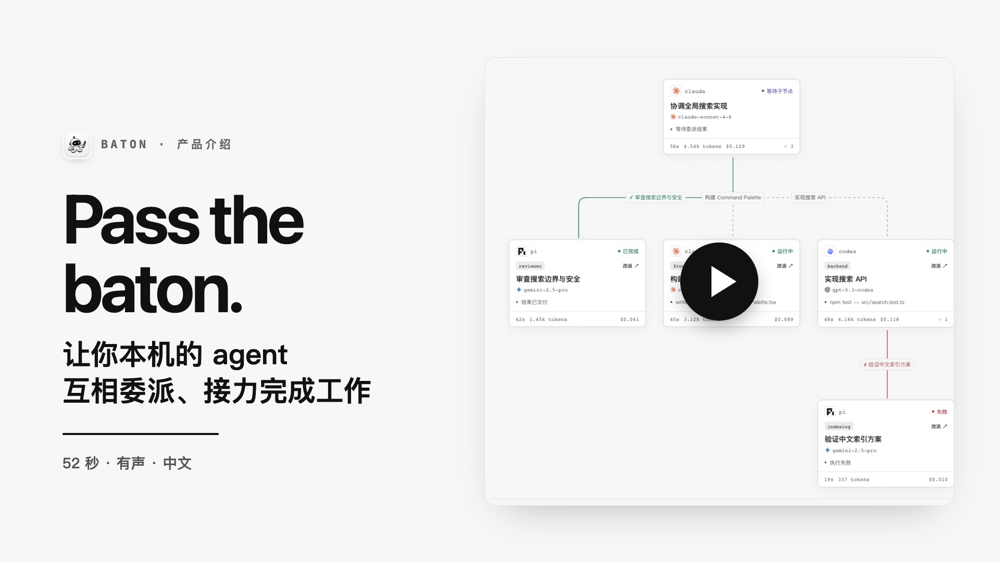](docs/media/baton-intro.mp4)

上方封面可点击播放：52 秒，中文说明配英文标题。片子里演示的是 baton 仓库自带的演示数据（「为工作台添加全局搜索」），没有真实项目内容。

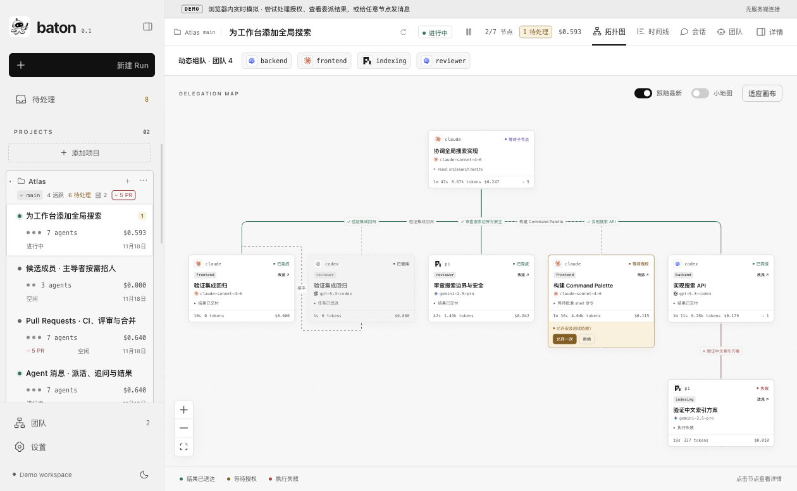

## 功能特性

- **用你已有的 agent**：内置 53 个 agent，其中 3 个原生驱动（Claude Code 走 Agent SDK、Codex 走 app-server、pi 走 RPC），50 个走 ACP（OpenCode、Qwen Code、Gemini CLI、Kimi、Copilot、Cursor、Grok、Goose 等）。启动时从 PATH 自动检测，带版本门槛和安装提示，所有规格都可以在 `config.json` 里覆盖。
- **天然委派**：每个 agent 节点都会注入专属的 `baton` MCP 服务（`delegate`、`wait`、`send`、`reassign`、`report_result`、`ask_human`、团队工具等）。任意 agent 可以跨厂商把子任务派给任意已检测到的 agent，结果自动回到发起方。
- **三种协作方式**：
  - **动态组队**：主导者先根据需求提出团队名单，你确认后再开工。
  - **预设团队**：按你保存好的团队直接执行。
  - **单人模式**：只用一个 agent 完成。
  - 执行过程中可以随时换人或改派。
  - 动态组队和预设团队都可以带**候选成员**：只填 agent、模型、思考级别和可选描述，不用定角色，主导者按任务自主招人。
- **人在回路**：跨会话的「待处理」收件箱，汇总权限请求、团队名单、内联问答卡片和升级事项。另有权限规则，消息支持排队、引导、立即发送（中断）三种发送模式，会话可以暂停和恢复，也可以把消息**回退**到之前（只回退会话、只回退文件，或两者一起）。
- **会话体验**：输入框实时渲染 Markdown；支持图片的 agent 可以在消息里插入图片（以胶囊显示），对话中直接显示图片；会话右侧的目录栏可以跳到你发过的每条消息。
- **可观测性**：实时委派拓扑图；会话时间线（自动折叠空闲时段）；完整对话记录（支持 GFM、Mermaid、中日韩排版）；每轮计时与思考动画；agent 在后台启动的常驻进程登记；agent 提交的 Pull Request 及其 CI 和评审状态。
- **项目与桌面端**：每个会话都归属一个项目（工作目录）。提供 macOS 和 Windows 桌面应用，选择目录时直接唤起系统对话框；同一套控制台也可以在浏览器里使用。亮色、暗色主题可切换。

## 截图

### 协作与团队

| 新建 Run：候选成员，模型从 agent 配置中选 | 团队名单确认 |
| --- | --- |
| 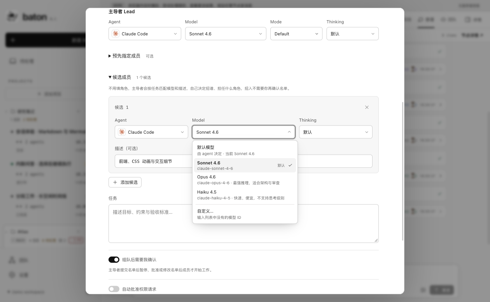 | 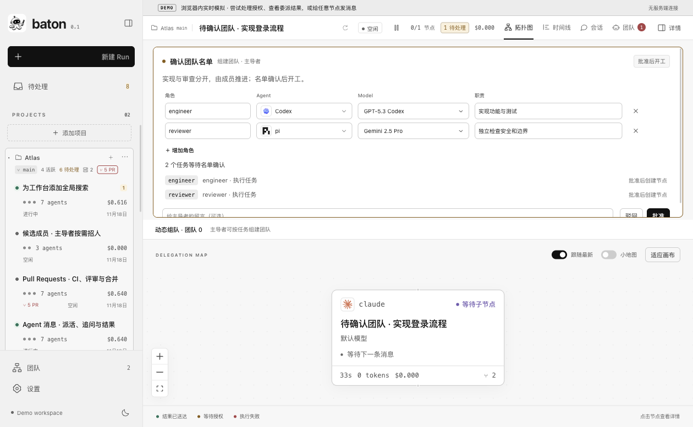 |
| **运行中的团队与候选成员** | **会话与 agent 往来消息** |
| 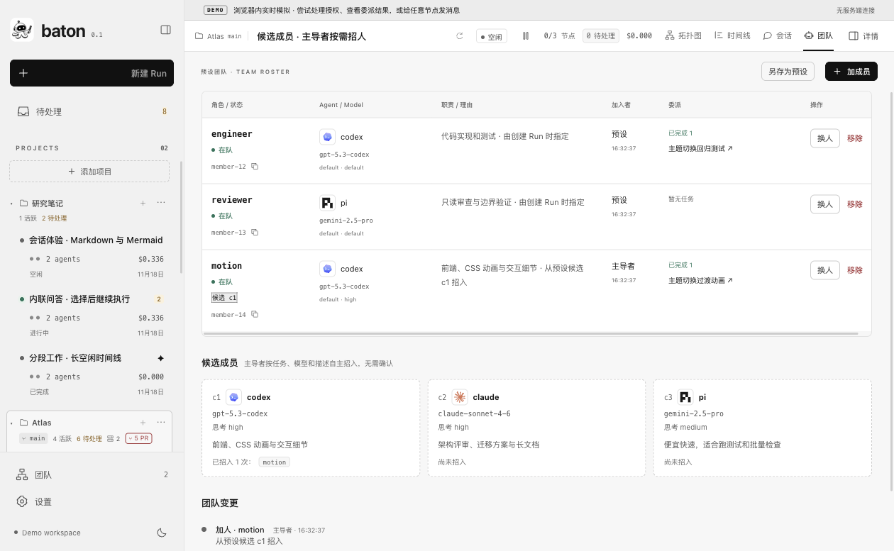 | 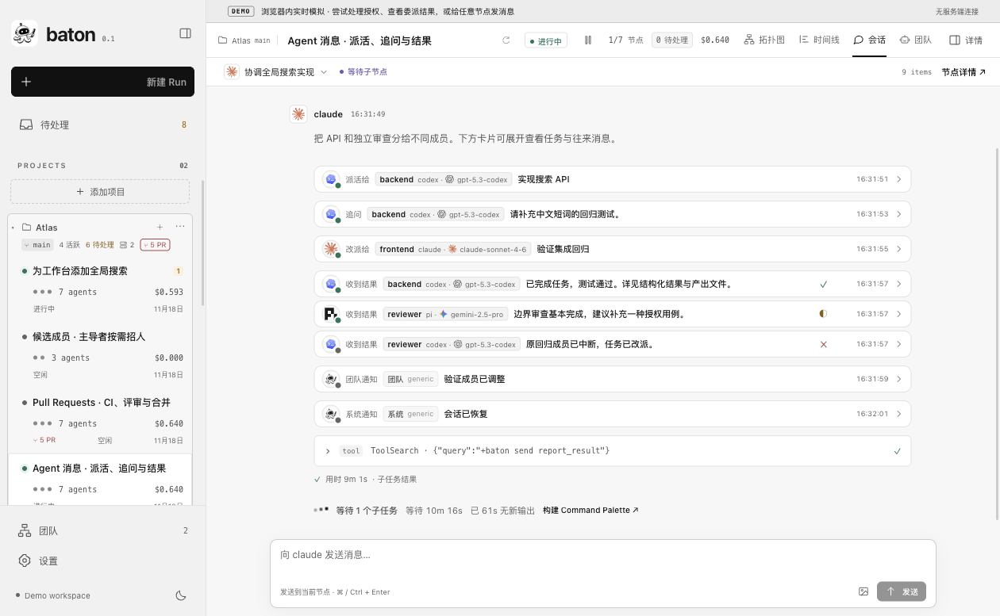 |

### 会话体验

| Markdown 渲染与会话目录栏 | Mermaid 图表 |
| --- | --- |
| 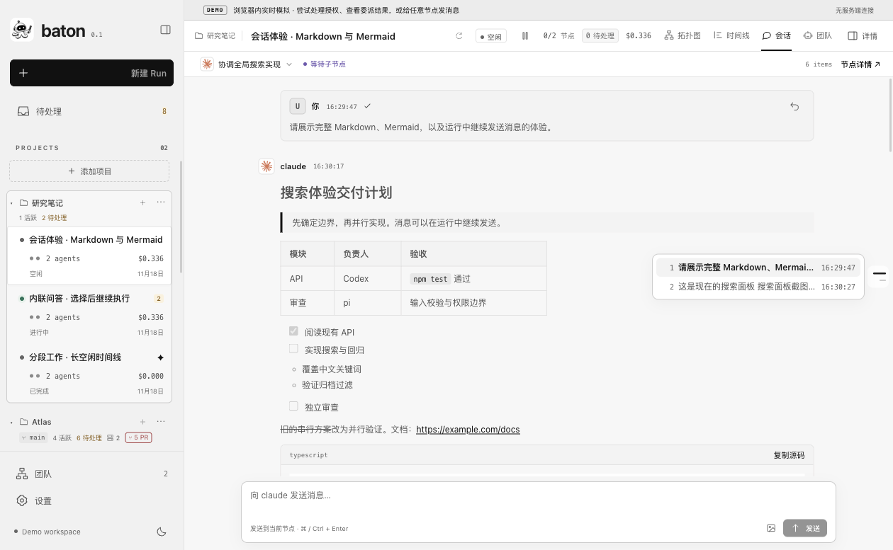 | 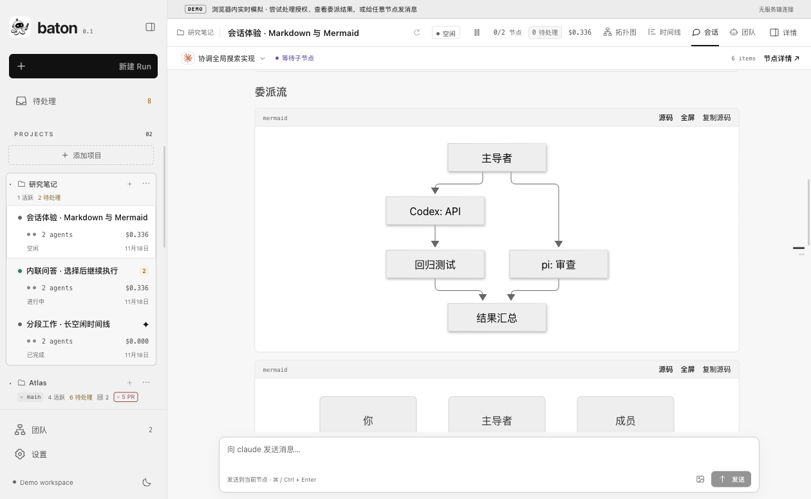 |
| **输入框：实时 Markdown 与图片胶囊** | **消息回退：会话、文件或两者** |
| 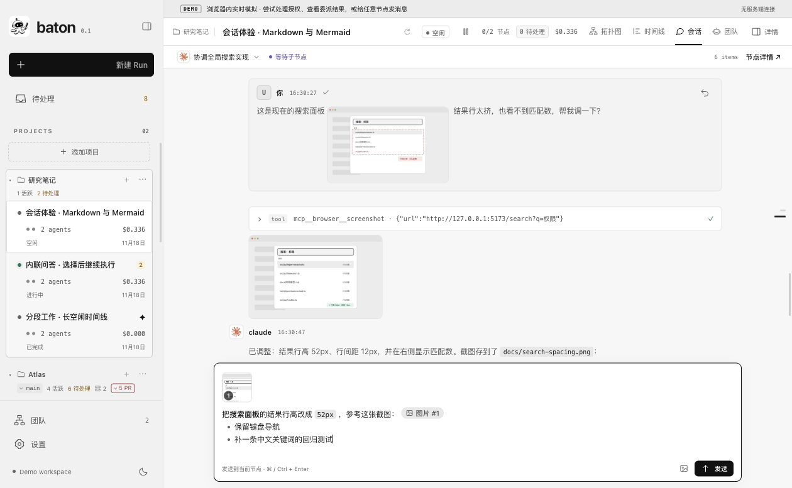 | 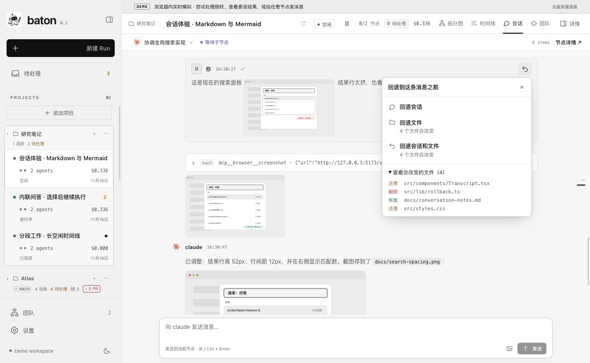 |

### 人在回路与可观测

| 内联问答卡片 | 待处理收件箱 |
| --- | --- |
| 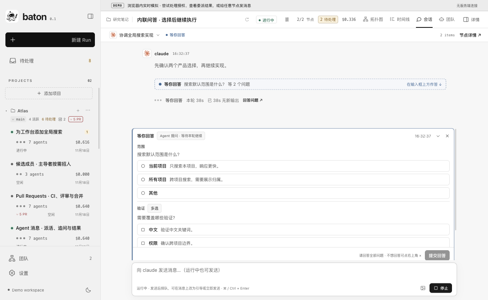 | 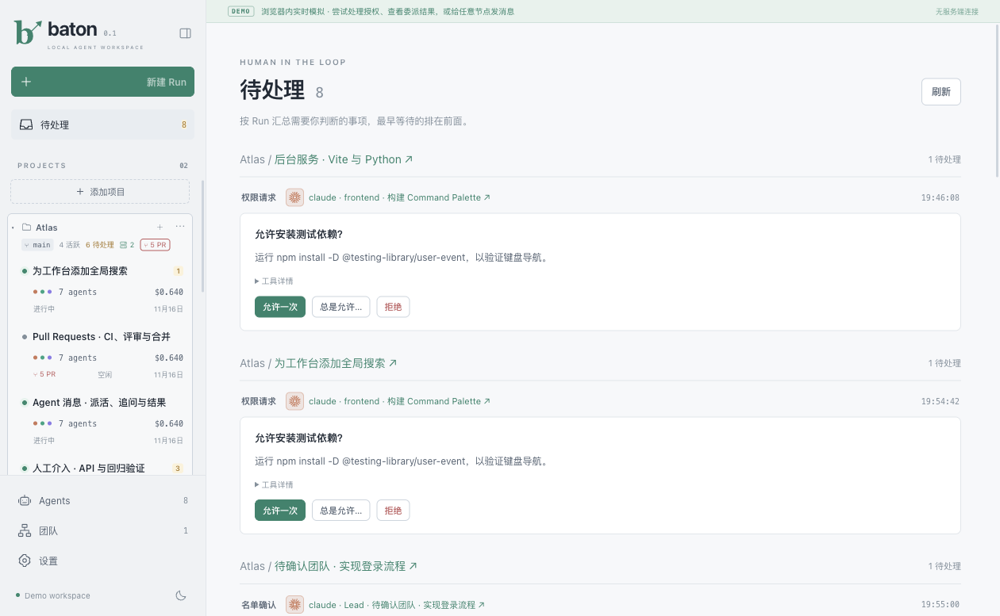 |
| **会话时间线（折叠空闲）** | **后台进程登记** |
| 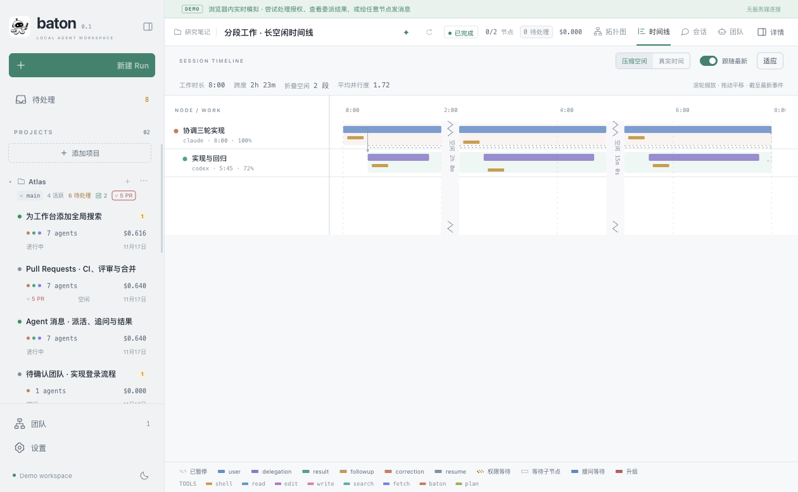 | 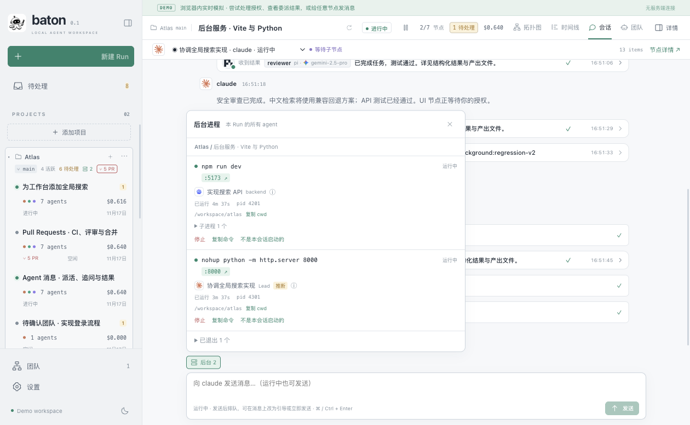 |
| **Pull Request 跟踪（CI 与评审）** | **暗色主题** |
| 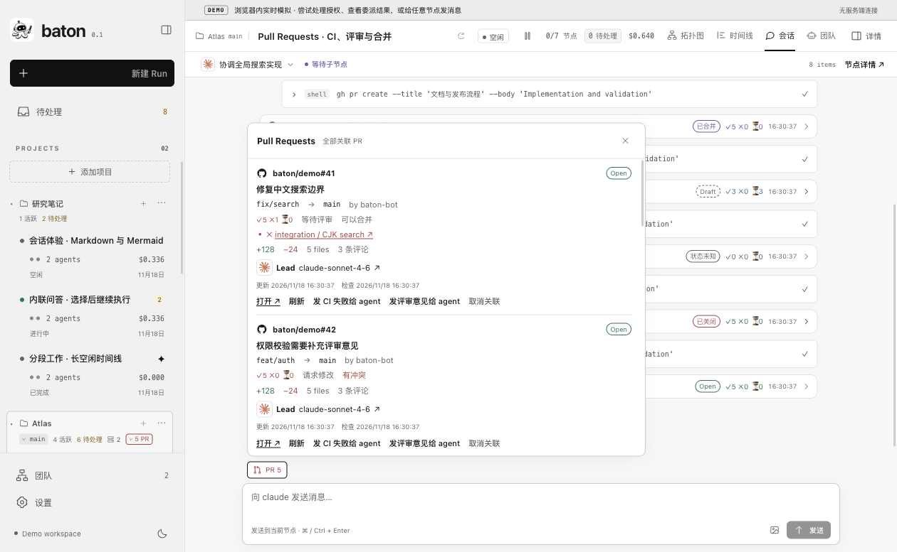 | 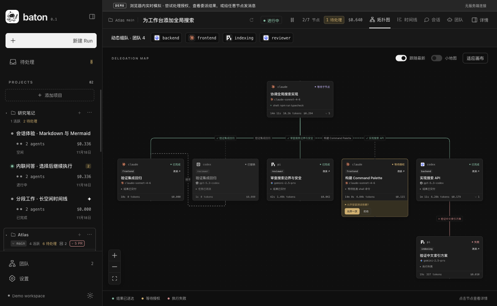 |

### Agent 检测

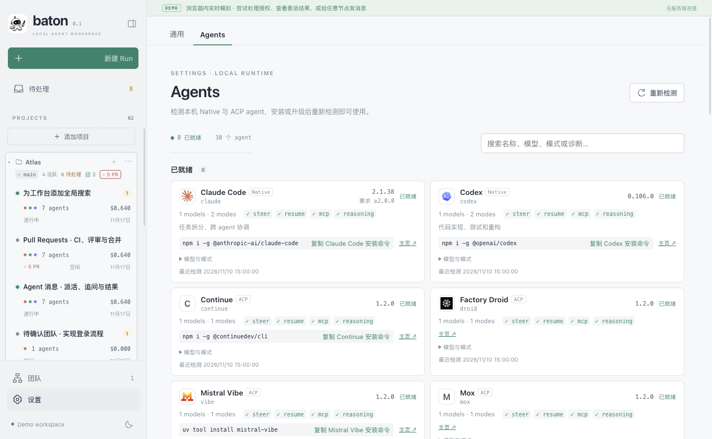

> 截图来自控制台内置的演示模式（不带 token 或加 `?demo=1` 打开即进入），不含真实项目数据。

## 安装

### 下载桌面版

到 [Releases](https://github.com/DueGin/baton/releases) 下载对应平台的安装包：

| 平台 | 文件 |
| --- | --- |
| macOS（Apple Silicon） | `baton-<版本>-mac-arm64.dmg` / `.zip` |
| macOS（Intel） | `baton-<版本>-mac-x64.dmg` / `.zip` |
| Windows x64 | `baton-<版本>-win-x64.exe`（安装器）/ `.zip`（免安装） |

目前的安装包**未签名**：

- **macOS**：首次打开请在 Finder 中右键 → 打开；或者执行 `xattr -dr com.apple.quarantine /Applications/baton.app`。
- **Windows**：如果 SmartScreen 拦截，点「更多信息 → 仍要运行」。

桌面版会在后台自带并管理 baton 守护进程，并读取登录 shell 的环境变量，所以在终端里能用的 agent CLI，在桌面版里同样能被检测到。

### 更新

桌面版可以自己更新，不用回来下载安装包：

1. 打开「设置 → 更新」，点「检查更新」。
2. 有新版本时点「下载」，安装包从 GitHub Releases 下载，完成后会用 `SHA256SUMS.txt` 校验。
3. 点「立即安装并重启」：应用退出（有活跃会话时会先确认），替换自身并自动重新打开。macOS 直接替换 `.app`，Windows 交给安装器静默安装。更新失败会恢复原来的版本。

仓库是公开的，不需要任何令牌就能检查和下载。令牌是可选的：GitHub 对匿名请求按 IP 限制每小时 60 次，如果经常点、或者要访问私有仓库的 Releases，可以在「设置 → 更新」里填一把有读取权限的令牌（Fine-grained token 给 **Contents: Read**，经典令牌用 `repo`），或者在登录 shell 里设置 `GITHUB_TOKEN`。令牌只存在本机的 `<用户数据目录>/desktop-settings.json`（权限 0600），不会上传到别处。

也可以照旧到 [Releases](https://github.com/DueGin/baton/releases) 手动下载覆盖安装，已有的项目、会话和设置都保留在 `~/.baton`。

### 从源码运行

需要 Node.js ≥ 22.13（推荐 24）。

```bash
npm install
npm run build                                         # protocol → providers → server → web
node packages/server/dist/cli/main.js serve           # 打开输出里的 http://127.0.0.1:7433/#token=…
node packages/server/dist/cli/main.js serve --fake    # 演示 agent，不需要安装任何 CLI
```

自己打包桌面版：`npm run dist:mac` 或 `npm run dist:win`。详见 [packages/desktop/README.md](packages/desktop/README.md)。

## 使用

1. **添加项目**：选择一个工作目录。每个会话都属于某个项目，agent 在该目录下工作。
2. **新建 Run**：选择主导 agent、模型和协作方式（动态组队 / 预设团队 / 单人），然后描述需求。
3. **观察与介入**：
   - 在「拓扑图」「时间线」「会话」三个视图之间切换。
   - 授权、名单确认、问答都会汇总到「待处理」。
   - 运行中发的消息默认排队，可以改为引导发送或立即发送。
4. **收尾**：agent 启动的后台服务显示在输入框左上角，可以一键停止；agent 提交的 PR 会显示在项目和会话里，并跟踪 CI 与评审状态。

数据存放在 `~/.baton`（可用 `BATON_HOME` 覆盖）。守护进程只监听 `127.0.0.1`，访问需要 `~/.baton/token` 里的令牌。

### 命令行

从源码运行时，下面的 `baton` 指 `node packages/server/dist/cli/main.js`：

```bash
baton agents [--refresh]                       # 查看检测到的 agent
baton projects | baton projects add <path>     # 管理项目
baton runs [--project ID|PATH]                 # 列出会话
baton run <agent> "<需求>" --project ID|PATH [--model ID] [--mode ID] [--auto-approve] [--follow]
baton export <runId> --format json|md|otlp [-o FILE]   # 导出记录（JSON / Markdown / OTLP）
```

## 委派工具

每个 agent 节点都会通过自己的 MCP 端点 `/mcp/n/<token>` 拿到下面这些工具。单人模式下只保留 `ask_human`。

| 工具 | 作用 |
| --- | --- |
| `list_agents` | 列出可委派的 agent、模型和能力 |
| `delegate` | 把子任务派给某个 agent 或团队角色 |
| `wait` / `get_result` / `status` | 等待、获取结果、查看子树状态与用量 |
| `send` | 向下属追加指令或回答（已完成的会重新打开） |
| `cancel` | 取消某个委派及其整棵子树 |
| `report_result` | 子节点提交结构化结果 |
| `ask_human` | 向人提问，在会话里显示为内联问答卡片 |
| `form_team` / `get_team` / `replace_member` / `reassign` | 组队、查看团队、换人、改派（组队和换人仅限主导者） |

设计细节见 [docs/DESIGN.md](docs/DESIGN.md)。

## 架构

<picture>
  <source media="(prefers-color-scheme: dark)" srcset="docs/images/architecture-dark.png">
  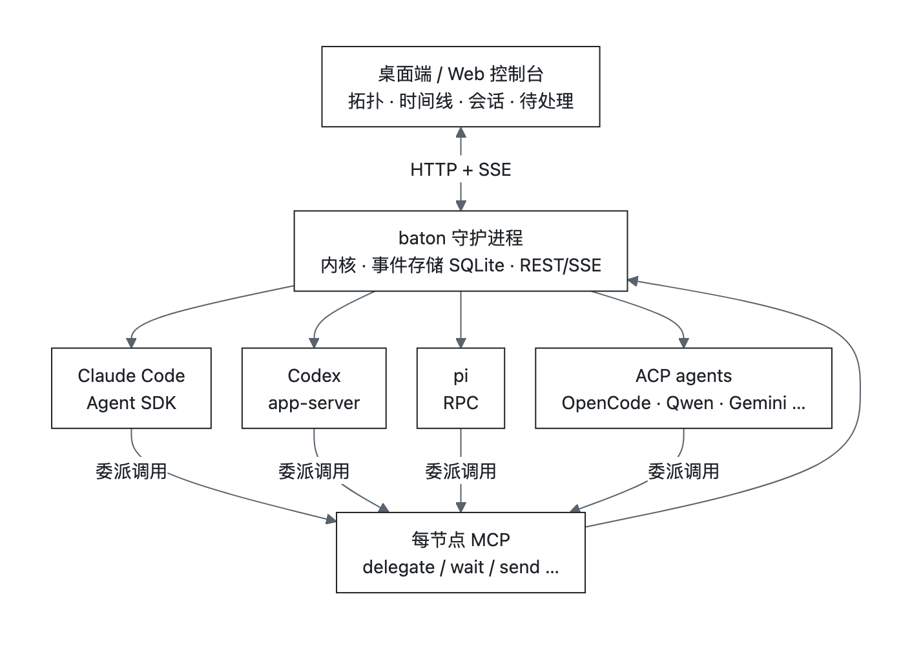
</picture>

图的源文件：[docs/architecture.mmd](docs/architecture.mmd)（Mermaid）。

| 包 | 说明 |
| --- | --- |
| `packages/protocol` | 共享类型、事件、MCP 工具定义 |
| `packages/providers` | agent 适配器（原生 + 数据驱动的 ACP 规格） |
| `packages/server` | 守护进程：内核、事件存储、HTTP/SSE、MCP、CLI |
| `packages/web` | React 控制台（React Flow 拓扑、时间线、Markdown/Mermaid） |
| `packages/desktop` | Electron 桌面壳（macOS / Windows） |

## 开发

```bash
npm run dev            # 用 tsx 启动守护进程
npm run dev:web        # Vite :5173，代理到 :7433；不带 token 时运行浏览器内演示
npm run typecheck && npx vitest run
npx tsx packages/server/scripts/smoke-drivers.ts claude codex pi   # 真实 CLI 冒烟（需要联网）
```

## 发版

推送 `v*` 标签就会触发 [Release 流水线](.github/workflows/release.yml)：

1. 在 macOS 和 Windows 上分别构建（macOS arm64 + x64，Windows x64）。
2. 版本号取自标签。
3. 生成 `SHA256SUMS.txt`，并创建 GitHub Release。

```bash
git tag v0.2.0 && git push origin v0.2.0          # 正式版
git tag v0.2.0-beta.1 && git push origin v0.2.0-beta.1   # 带 - 后缀的标签发布为预发布版
```

在 Actions 页面手动运行（workflow_dispatch）只构建产物，不发布 Release。

## 许可与致谢

[Apache-2.0](LICENSE)。

- agent 适配器移植自 [Paseo](https://github.com/getpaseo/paseo)（Apache-2.0），见 [NOTICE](NOTICE)。
- 内置 ACP agent 启动表参考了 [acpx](https://github.com/openclaw/acpx)（MIT）。
