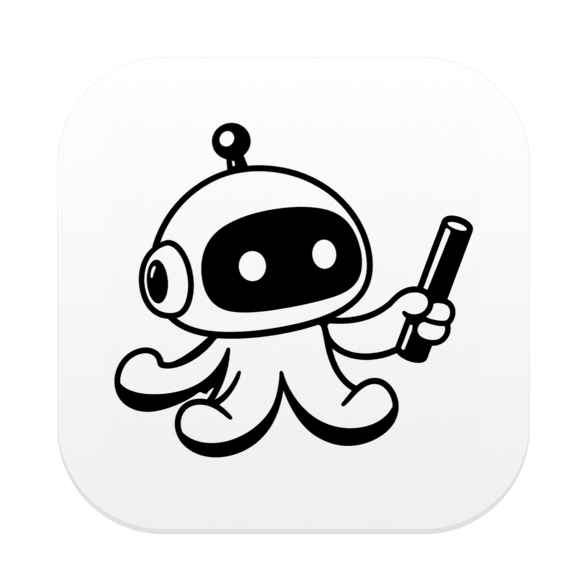
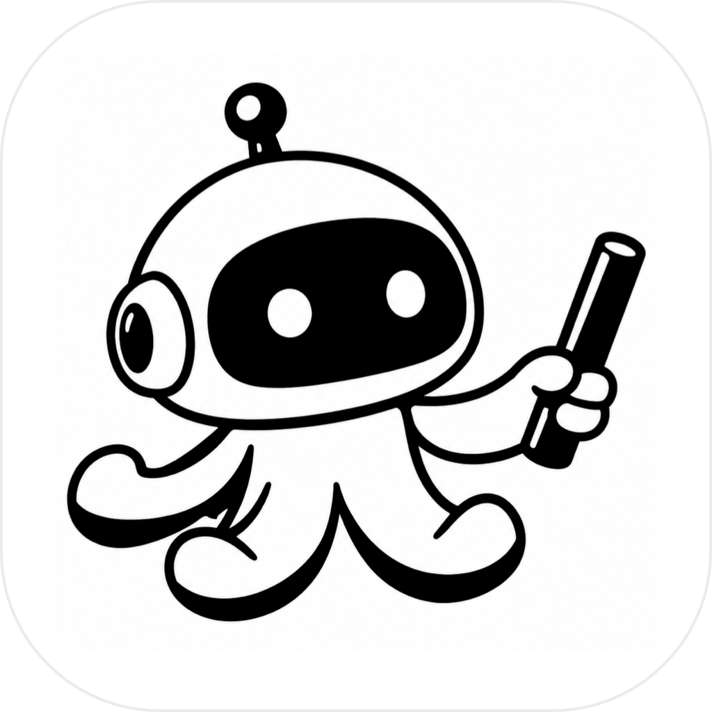
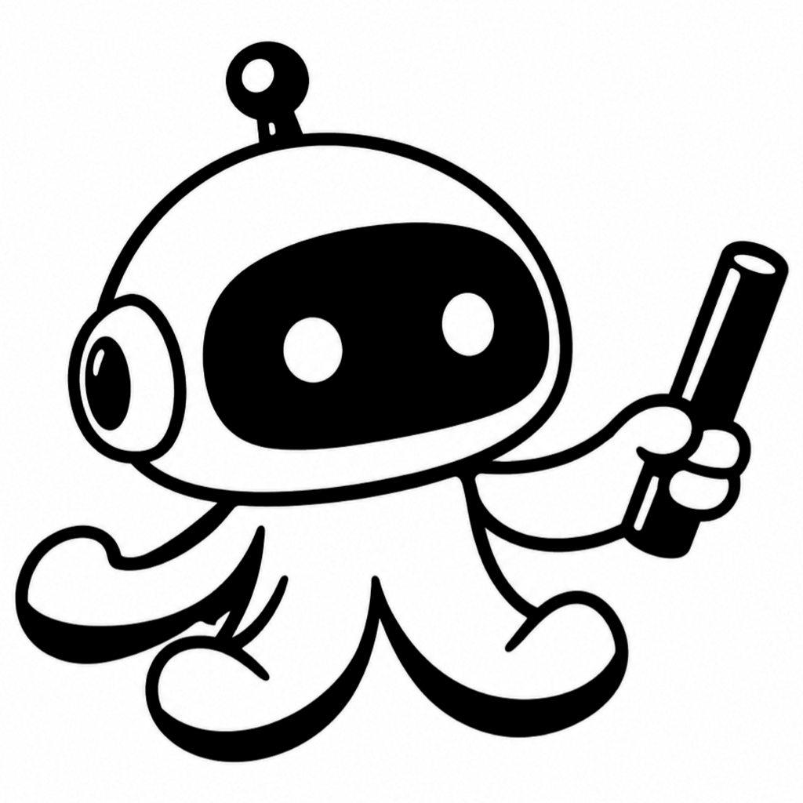

# baton 品牌素材

  

**章鱼机器人**：一个多臂的 agent，其中一只手把接力棒递出去。多只手代表多 agent 协作，递出接力棒代表委派。风格是极简黑白墨线，配白色圆角方块。

| 文件 | 用途 |
|---|---|
| `baton-art.png` | 原始插画（gpt-image-2 生成，白底，1024²） |
| `baton-mark.png` | 透明底黑色标志，适合放在浅色背景上 |
| `baton-icon.png` | macOS 规格的应用图标（824/1024 圆角方块，带留白和阴影），桌面端母版 |
| `baton-badge.png` | 铺满的圆角徽标，用于侧边栏和 favicon 等小尺寸场景 |

使用位置：

- 桌面端：`packages/desktop/assets/logo.png`（= `baton-icon.png`）和 `logo-small.png`（16–48 px 专用的放大版）。运行 `npm run icons:render -w @baton/desktop` 重新生成 `icon.png`、`icon.ico`、`icon.icns`，需要 macOS。
- Web 控制台：`packages/web/public/favicon.png`、`apple-touch-icon.png`，以及侧边栏的 `packages/web/src/assets/baton-icon.png`。

生成提示词：

```text
Subject: a friendly small octopus-like robot agent with a round dome head, a solid black visor with two white dot eyes, and four short curled arms; one arm hands a short relay baton forward to the right while the other arms are relaxed. Playful but tidy. Monochrome black-and-white ink line illustration. Drawn with bold, confident, smooth black contours of varying thickness plus a few solid black filled areas, with clean white negative space. No grey tones, no gradients, no color, no shading texture, no hatching. Minimal and elegant with very few lines, simple enough to stay readable at 32 px. The subject is centered and fills about 68% of a pure white square canvas with even white margins. Pure white background. No text, no letters, no numbers, no watermark, no border, no frame, no rounded tile, no existing logo, no known character.
```
